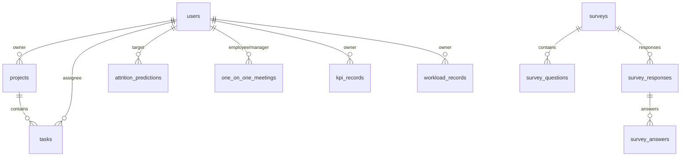
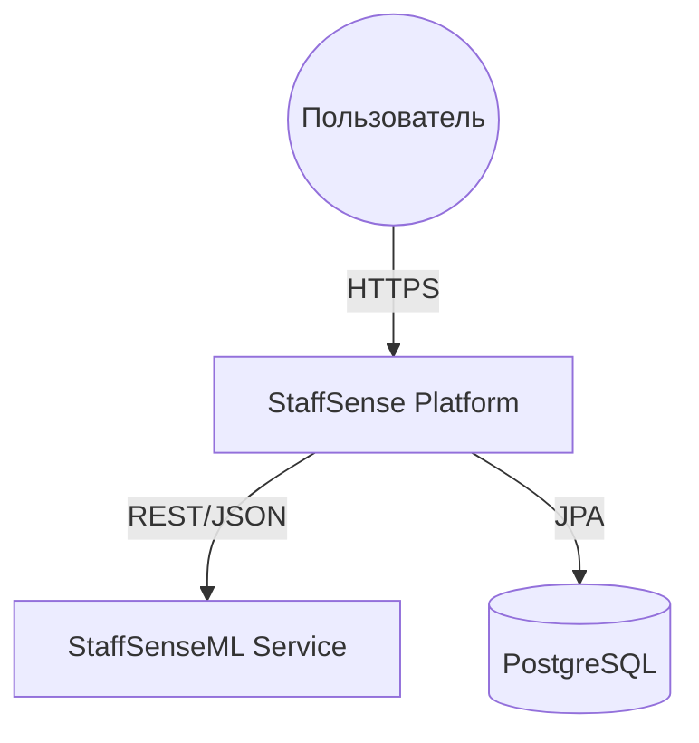
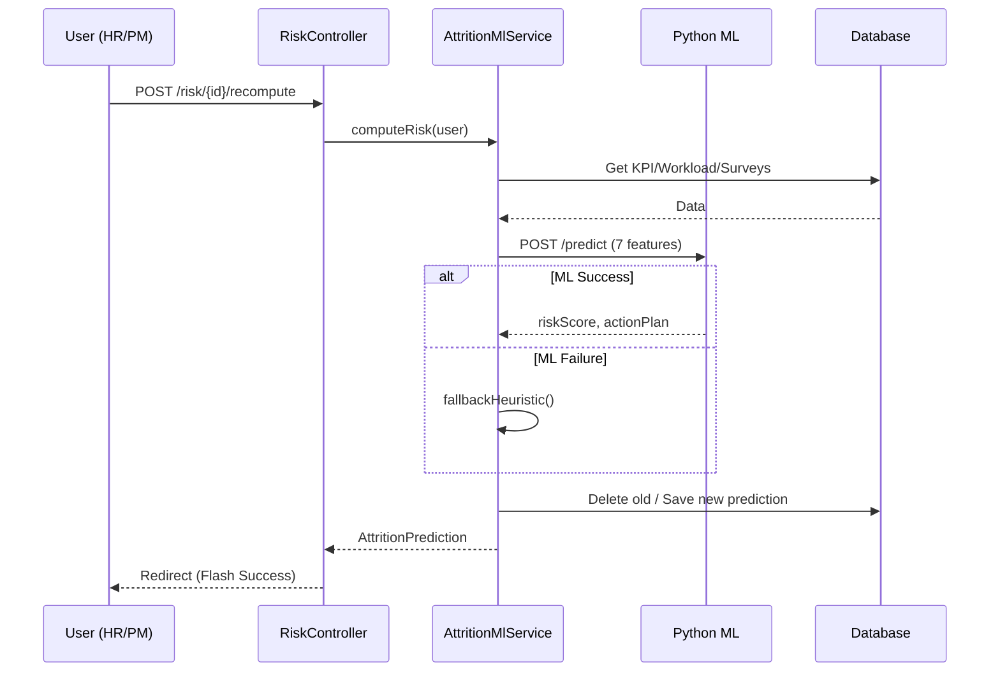

# STAFFSENSE — ENGINEERING DISCOVERY REPORT

> **Примечание при публикации.** Отчёт приведён в исходном виде (фаза Discovery).
> Значение пароля БД отредактировано: `<пароль скрыт>`.
**Дата отчета:** 2026-10-09  
**Версия отчета:** 1.0  
**Автор:** Senior Software Architect (DeepSeek Harness)  

## 1. Резюме (Executive Summary)
В ходе фазы **Discovery (Phase 0)** был проведен полный аудит платформы **StaffSense** (Java/Spring Boot) и микросервиса **StaffSenseML** (Python/FastAPI). 
Общий вердикт: система находится в рабочем состоянии (Smoke-тесты пройдены), однако выявлены критические дефекты в модуле генерации данных для машинного обучения и серьезные пробелы в безопасности (🔴 SECURITY GAP), требующие устранения до перехода к Фазе 3. 

Ключевой риск: ML-модель в текущей конфигурации **не обучается** из-за некорректного формата CSV и **инвертирует логику риска** из-за ошибок в формулах генерации.

---

## 2. Структура воркспейса и репозиториев

### 2.1 Расположение компонентов
```text
WORKSPACE (C:\Users\Argen\Products\)
│
├── StaffSense (Git-репозиторий, ветка main, 4 коммита)
│   ├── demo\              <-- Монолит Spring Boot (Порт 9091)
│   ├── ml-service\        <-- Legacy ML сервис (Порт 8001, FastAPI)
│   ├── docs\              <-- Документация MkDocs
│   └── dataset_training.csv <-- Игнорируемый Git датасет (СЛОМАН)
│
└── StaffSenseML           <-- Локальная папка (пустая заготовка PyCharm)
    └── main.py            <-- Template hello-world
```
**Конфликт:** ТЗ описывает `StaffSenseML` как полноценный репозиторий с `services.py` и `schemas.py`. На диске локально этот код отсутствует, он найден только во внешнем репозитории [AGNARE/StaffSenseML](https://github.com/AGNARE/StaffSenseML).

---

## 3. Архитектура систем

### 3.1 StaffSense (Java)
*   **Стек:** Java 21 (Corretto), Spring Boot 3.2.5, Spring Data JPA, Hibernate, Spring Security 6.
*   **Сборка:** Maven Wrapper (mvnw 3.9.16).
*   **БД:** PostgreSQL 18 (Порт 5433). Схема управляется `ddl-auto: update`.
*   **Фронтенд:** Thymeleaf (SSR) + Chart.js.

### 3.2 StaffSenseML (Python)
*   **Стек:** Python 3.14.0 (venv), FastAPI, scikit-learn, Pydantic v2.
*   **Модель:** LogisticRegression (L2, C=1.0, balanced weights).
*   **Интеграция:** Java вызывает Python через `RestTemplate` (JSON POST).

---

## 4. База данных (ERD)

Фактическая модель данных состоит из **11 таблиц**. Индексы на внешних ключах (FK) отсутствуют.



---

## 5. Безопасность (Security Audit)

### 5.1 Матрица ролей (Фактическая)
| Роль | /admin | /risk | /employees | /analytics | /api/tasks |
|---|---|---|---|---|---|
| ADMIN | ✅ | ✅ | ✅ | ✅ | ✅ |
| HR | ❌ | ✅ | ✅ | ✅ | ✅ |
| PM | ❌ | ✅ | ✅ | ✅ | ✅ |
| EXEC | ❌ | ✅ | ❌ | ✅ | ✅ |
| EMPLOYEE| ❌ | ❌ | ❌ | 🔴 ✅ | 🔴 ✅ |

### 5.2 Критические уязвимости (🔴 SECURITY GAPs)
1.  **Утечка данных через /analytics:** Любой EMPLOYEE видит риск-прогнозы и KPI коллег по прямому URL, так как `/analytics/**` разрешен для всех аутентифицированных.
2.  **Неконтролируемое изменение задач:** `/api/tasks/**` не имеет проверок ролей и **CSRF-защиты**. Любой пользователь может удалять/менять чужие задачи.
3.  **IDOR в 1:1:** Отсутствует проверка владения встречей в методах `complete` и `cancel`.
4.  **Секреты в коде:** Пароль БД `<пароль скрыт>` открыт в `application.yml`.
5.  **CSV-инъекция:** Поля свободного ввода в опросах не экранируются при экспорте.

---

## 6. API Контракт Java ↔ Python

### 6.1 Запрос (POST /api/v1/predict)
```json
{
  "userId": 1,
  "salary_ratio": 0.85,
  "workload_index": 1.45,
  "kpi_norm": 0.62,
  "tenure_months_norm": 0.35,
  "satisfaction_norm": 0.48,
  "missed_1on1_ratio": 0.15,
  "overtime_norm": 0.72
}
```
**Проблема интеграции:** В Java `RestTemplate` не настроены таймауты (бесконечное ожидание), что может привести к зависанию всей платформы при сбое ML.

---

## 7. ML Пайплайн

1.  **Генератор (DatasetGenerator):** СЛОМАН. Десятичная запятая в CSV делает его нечитаемым для Python.
2.  **Логика признаков:** Знаки инвертированы (высокая зарплата = высокий риск).
3.  **Fallback:** Если ML недоступен, Java использует эвристику: `score = 50 + 15(workload>1.3) + 10(salary<0.9) + 10(satisfaction<0.5)`.
4.  **Качество:** Точность (Accuracy) заявлена 0.69, но реально модель не обучается на имеющихся данных.

---

## 8. ТЗ vs КОД (Traceability & Conflicts)

| Функция | ТЗ (Требование) | Код (Реализация) | Статус |
|---|---|---|---|
| Роли | ADMIN, HR, PM, EXEC, EMPLOYEE | Совпадает | 🟢 OK |
| CSRF | Включен везде | **Выключен для /api/** | 🔴 GAP |
| Веса KPI | Конфигурируемые (yml) | **Захардкожены (W1, W2, W3)** | ⚠️ CONFLICT |
| Веса в UI | Должны быть обученными | **Статичные копии (1.2, 1.0...)** | ⚠️ CONFLICT |
| История рисков| Хранить историю | **Удаляет старые записи** | ⚠️ CONFLICT |
| Пропущенные 1:1| Автопометка | **Отсутствует (нет Scheduler)** | 🔴 MISSING |
| Табель/Записки | Фаза 3 | Отсутствуют | 🔵 PLANNED |

---

## 9. Технический долг

### Critical
*   Исправление разделителя в CSV (`Locale.US`).
*   Исправление знаков в формуле генерации.
*   Закрытие прав на `/analytics` и `/api/tasks`.

### High
*   Включение CSRF для API.
*   Внедрение `Flyway` для миграций.
*   Реализация `manager_rating` в расчете KPI.

---

## 10. Архитектурные диаграммы

### 10.1 Системный контекст (C4 L1)


### 10.2 Диаграмма последовательности: Расчет риска


---

## 11. Рекомендации
1.  **Немедленно исправить `DatasetGenerator.java`**, чтобы восстановить обучаемость модели.
2.  **Ужесточить `SecurityConfig`**, ограничив роль `EMPLOYEE` только личным дашбордом и своими задачами.
3.  **Добавить проверку владельца (Manager/Assignee)** в сервисы 1:1 и Задач.
4.  **Удалить пароль БД** из репозитория, переведя его в переменные окружения.
5.  **Настроить таймауты** в `RestTemplateConfig`.

**Discovery Phase 0 завершена. Проект готов к исправлению багов и переходу к реализации Фазы 3.**
